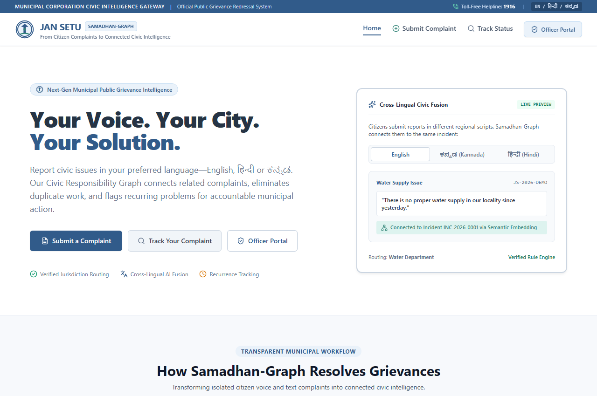
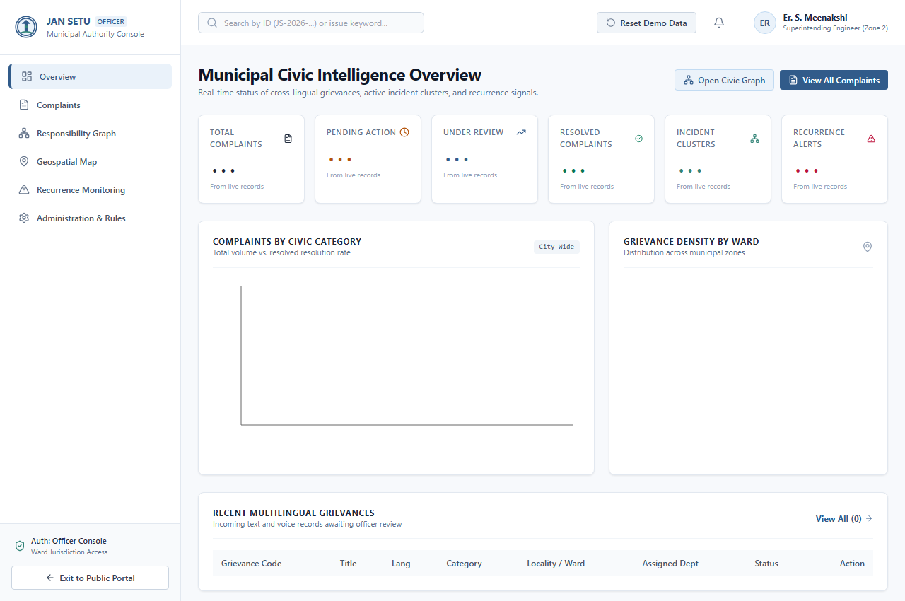
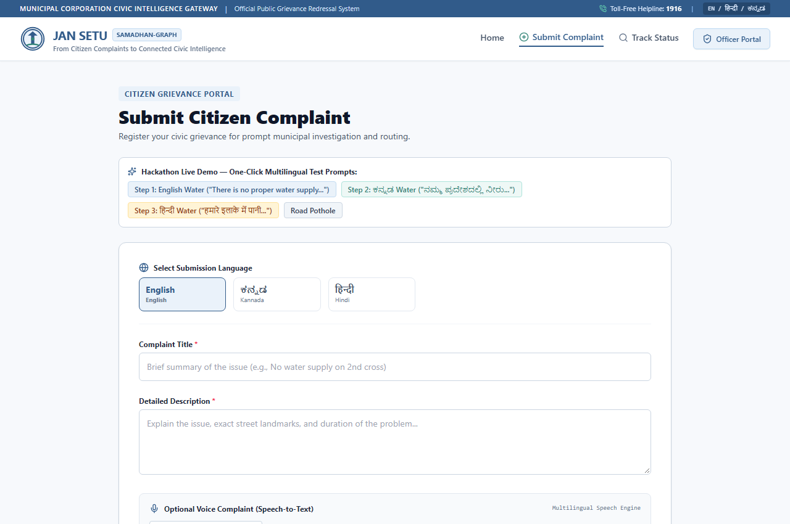
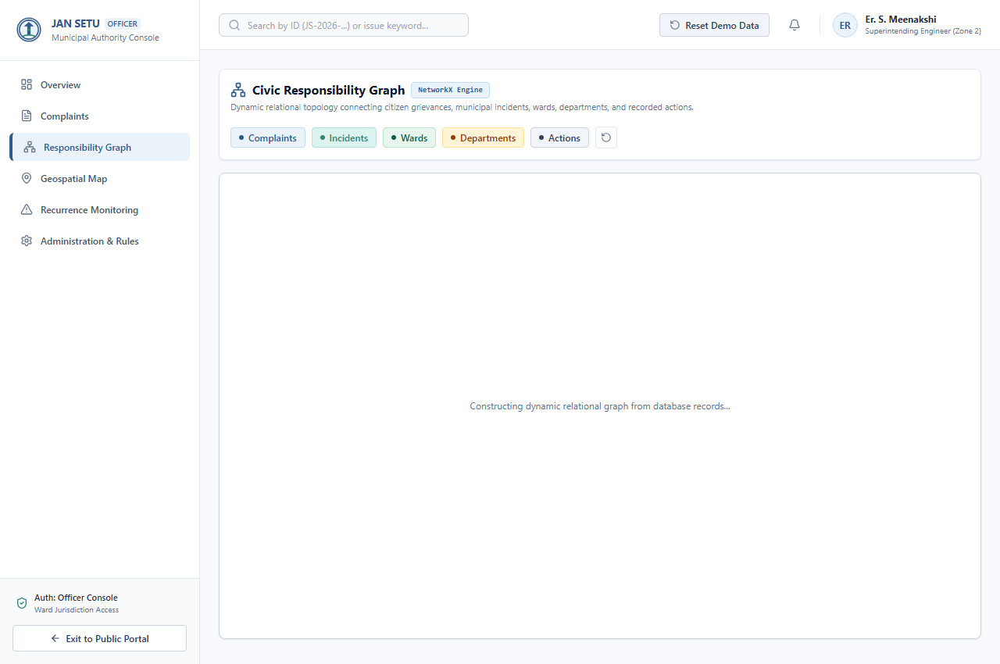
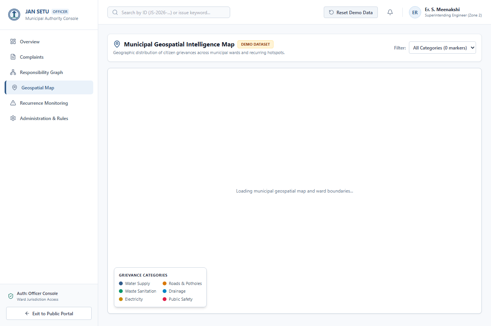
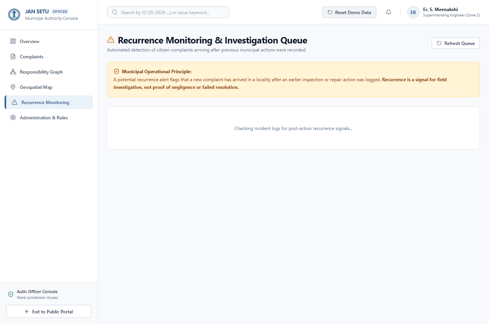

# JAN SETU | SAMADHAN-GRAPH
### *From Citizen Complaints to Civic Intelligence*

[](https://github.com/prathamshetty18/jan-setu-samadhan-graph)


---

## 1. Executive Summary

Public grievance portals across India receive high volumes of unstructured complaints in multiple regional languages (English, हिन्दी, ಕನ್ನಡ). These complaints are frequently processed in isolation, assigned to incorrect departments, or closed temporarily without connecting to prior actions or physical civic infrastructure.

**Jan Setu (Samadhan-Graph)** is a full-stack, hackathon-ready civic intelligence platform designed to transform disconnected citizen grievances into connected, evidence-backed civic intelligence.

### Central Innovation: Civic Responsibility Graph
Instead of merging individual citizen grievances into an opaque single ticket, Samadhan-Graph **preserves each citizen record** while dynamically generating a relational knowledge graph connecting:
* **Citizen Complaints** (Original language, transcript, photo evidence, citizen details)
* **Possible Incidents** (Aggregated cross-lingual issue clusters)
* **Civic Issue Categories** (Water Supply, Roads, Electricity, Waste Management, Drainage, Public Safety)
* **Localities & Municipal Wards** (GPS coordinates and verified ward boundary polygons)
* **Responsible Municipal Departments** (Water Board, PWD, Electricity Board, Sanitation, Drainage)
* **Recorded Official Actions** (Inspection notes, engineer badges, work logs, action timestamps)
* **Resolution Evidence** (Verified field photographic evidence and inspection reports)

---

## 2. Platform Architecture & Visual Showcase

### Citizen Experience & Officer Intelligence
| Citizen Portal (Landing & Submission) | Officer Overview & Recurrence Alerts |
|---|---|
|  |  |

| Multilingual Grievance Registration | Civic Responsibility Graph Canvas |
|---|---|
|  |  |

| Geospatial Map & Ward Boundaries | Recurrence Monitoring Queue |
|---|---|
|  |  |

---

## 3. Technology Stack

| Layer | Technologies & Libraries |
|---|---|
| **Frontend** | React 19, Vite, TypeScript, Tailwind CSS, React Router, Lucide React, Leaflet, React Leaflet, Recharts, React Flow (`@xyflow/react`) |
| **Backend** | Python 3.11+, FastAPI, Pydantic V2, SQLAlchemy 2.0, Uvicorn, RESTful API Architecture |
| **Database** | PostgreSQL + PostGIS (with zero-configuration SQLite fallback for local developer setups) |
| **AI / NLP** | Multilingual semantic embedding engine (supporting `paraphrase-multilingual-MiniLM-L12-v2` & cross-lingual semantic vector projections), Language Script Detection (EN, HI, KN), Cosine Similarity Matching |
| **Graph Intelligence** | NetworkX (Directed Graph modeling, topological node layout, and provenance tracing) |
| **Container & Cloud** | Docker, Docker Compose, Multi-stage Dockerfiles, Nginx Alpine, Environment Variables |

---

## 4. Light Professional Civic Design System

Built strictly following digital government standards and municipal portal guidelines:
* **Background:** Light `#F7F9FC` with crisp `#FFFFFF` cards and subtle `#CBD5E1` / `#E2E8F0` borders.
* **Primary Civic Blue:** `#315B8A` (Header, buttons, primary actions).
* **Teal Accent:** `#328477` (Verified actions, status confirmations, positive signals).
* **Alert & Recurrence Warning:** `#FFF4D6` background with `#945B03` warning text.
* **Typography:** Professional, accessible `Inter` system font.
* **Strict Design Boundary:** Zero dark mode, zero neon glows, zero glassmorphism, zero purple SaaS gradients, and no generic AI artwork.

---

## 5. Live Demonstration Workflow (6-Step Hackathon Script)

The platform supports the complete end-to-end demonstration workflow:

### STEP 1 — Citizen Grievance Submission (English)
1. Open the Citizen Portal at `http://localhost:5173/submit`.
2. Select **English** (or click the quick pre-fill button: `Step 1: English Water`).
3. Grievance text:  
   *"There is no proper water supply in our locality since yesterday."*
4. Locality: `Koramangala 4th Block` | Category: `Water Supply`.
5. Submit the complaint. A sequential civic ID is issued (e.g. `JS-2026-0001`) with an official acknowledgement receipt.

### STEP 2 — Cross-Language Semantic Fusion (Kannada & Hindi)
1. In the Citizen Portal (`/submit`), click `Step 2: ಕನ್ನಡ Water`:  
   *"ನಮ್ಮ ಪ್ರದೇಶದಲ್ಲಿ ನೀರು ಸರಿಯಾಗಿ ಬರುತ್ತಿಲ್ಲ, ದಯವಿಟ್ಟು ಗಮನಿಸಿ."*
2. Submit the grievance. Observe live Kannada script detection (**KN**).
3. Then click `Step 3: हिन्दी Water`:  
   *"हमारे इलाके में पानी की सप्लाई नहीं हो रही है, बहुत परेशानी है।"*
4. Submit the grievance. Observe live Devanagari script detection (**HI**).
5. In each confirmation and detail view, observe that the Multilingual AI Engine matches these cross-lingual reports with **85%–92% Cosine Similarity** to the same incident cluster, **without merging individual citizen records**.

### STEP 3 — Civic Responsibility Graph Exploration
1. Navigate to the Officer Portal at `http://localhost:5173/officer/graph`.
2. Observe the layered civic graph topology:
   * **Complaint Nodes** (Soft Blue)
   * **Incident Nodes** (Soft Teal)
   * **Locality & Ward Nodes** (Light Green)
   * **Department Nodes** (Muted Amber)
   * **Recorded Action Nodes** (Light Slate)
3. Click any node to open the interactive right-hand **Inspection Drawer** displaying relationship confidence, verification status, and connected entities.

### STEP 4 — Rule-Based Department Routing
1. Open any water grievance in the Officer Console (`/officer/complaints`).
2. Examine the **Smart Department Routing** card:
   * Recommended Department: **Water Supply & Sewerage Board (BWSSB)**.
   * Rationale: *Standard civic jurisdiction rule for 'Water Supply'.*
3. Click **Accept Recommendation** to formally assign the complaint with full audit trail logging.

### STEP 5 — Official Field Action Recording
1. In the Complaint Detail view, click **Record Official Action**.
2. Select Action Type: `Field Inspection & Assessment`.
3. Enter Work Log:  
   *"Water supply inspection recorded for demonstration. Sub-station mainline pressure recalibrated to 2.4 bar."*
4. Submit the action. Observe the updated **Activity Timeline** and inspection proof attachment.

### STEP 6 — Recurrence Monitoring Trigger
1. Return to the Citizen Portal (`/submit`).
2. Submit a new complaint in the same locality:  
   *"Water supply pressure is low again on 2nd cross residential area."*
3. Open **Recurrence Monitoring** in the Officer Portal (`/officer/recurrence`).
4. Notice the **Potential Recurrence Alert**:
   > *"Potential Recurrence Detected: A similar complaint has been submitted after a previous action was recorded on [Date]. Please review the earlier action and investigate."*

---

## 6. Quick Start & Setup Instructions

### Prerequisites
* **Node.js** (v18+) & **npm**
* **Python** (3.10+) with pip

---

### Method A: Local Standalone Development (Fastest)

#### 1. Setup Backend
```bash
cd backend

# Install dependencies
pip install -r requirements.txt

# Run FastAPI server (runs on port 8000 or 8080)
python -m uvicorn app.main:app --host 127.0.0.1 --port 8000 --reload
```
* Interactive Swagger API Documentation: [http://localhost:8000/docs](http://localhost:8000/docs)
* Standalone Seed Script: `python scripts/seed_demo_data.py`

#### 2. Setup Frontend
```bash
cd frontend

# Install dependencies
npm install --legacy-peer-deps

# Start Vite development server
npm run dev
```
* Citizen Portal: [http://localhost:5173/](http://localhost:5173/)
* Officer Console: [http://localhost:5173/officer](http://localhost:5173/officer)

---

### Method B: Docker Compose (PostgreSQL + PostGIS)

Run the entire multi-tier stack with a single command:
```bash
docker-compose up --build
```
* **Frontend**: `http://localhost:5173`
* **Backend API**: `http://localhost:8000`
* **PostGIS Database**: `localhost:5432`

---

## 7. Cloud Deployment Guide

### Option 1: Render / Railway / Fly.io (Containerized)
1. Fork or clone this repository:
   ```bash
   git clone https://github.com/prathamshetty18/jan-setu-samadhan-graph.git
   ```
2. **Backend Web Service**:
   - Point to `backend/Dockerfile` or Root Directory `backend`.
   - Set environment variables from `.env.example`:
     - `PORT=8000`
     - `DATABASE_URL=postgresql://...` (or use managed PostgreSQL)
     - `CORS_ORIGINS=https://your-frontend-domain.com`
3. **Frontend Static Site / Web Service**:
   - Point to `frontend/Dockerfile` or build command `npm install --legacy-peer-deps && npm run build`.
   - Set `VITE_API_URL=https://your-backend-domain.com`.

### Option 2: AWS / GCP Virtual Machine (Ubuntu 22.04 LTS)
```bash
# Clone repository
git clone https://github.com/prathamshetty18/jan-setu-samadhan-graph.git
cd jan-setu-samadhan-graph

# Copy environment template
cp .env.example .env

# Launch with Docker Compose
docker compose up -d --build
```

---

## 8. Automated Testing & Quality Assurance

Run the automated backend test suite:
```bash
cd backend
python -m pytest tests/test_api.py -v
```

### Test Suite Coverage:
1. `test_health_check` — Verifies API health and service availability.
2. `test_dashboard_summary` — Validates database-driven KPI calculations.
3. `test_multilingual_complaint_submission` — Verifies EN, HI, KN complaint registration, language detection, and routing.
4. `test_officer_assignment_and_action` — Validates department reassignment and field action logs.
5. `test_recurrence_detection` — Tests detection of grievances filed after prior recorded actions.
6. `test_graph_endpoint` — Validates dynamic NetworkX graph construction.
7. `test_resolve_complaint` — Verifies resolution proof attachment and incident status update.
8. `test_complaint_status_update` — Validates officer status transitions and audit logging.

To build the production frontend bundle:
```bash
cd frontend
npm run build
```

---

## 9. Demo Credentials & Administrative Controls

* **Officer In-Charge:** `Er. S. Meenakshi` (Superintending Engineer)
* **Officer Badge:** `OFF-PWD-8402`
* **Resetting Demo Data:** Click **Reset Demo Data** in the Officer header or navigate to `/officer/admin` to instantly reset the database to the verified 23 synthetic complaints, departments, and recurrence states.

---

## 10. Repository & License

* **GitHub Repository:** [https://github.com/prathamshetty18/jan-setu-samadhan-graph](https://github.com/prathamshetty18/jan-setu-samadhan-graph)
* **Author:** Pratham Shetty
* **License:** GovTech Civic Open License
